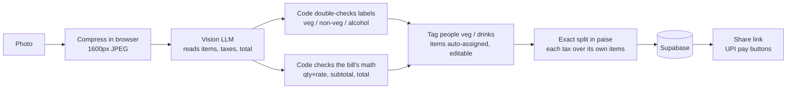

# Receipt Bill Splitter

Snap a restaurant bill, tag who's vegetarian and who drinks, and send everyone a link with a one-tap **UPI payment**
for their exact share. Items are assigned automatically, GST is split over food and liquor VAT only among the
people who drank.

**Live demo:** https://YOUR-APP.vercel.app · Use "Try a sample bill" (fictional receipt).

> **Problem:** after a group dinner someone pays, then has to type every item into a splitting app, work out
> who owes what including tax, and chase people for money. Splitting equally isn't fair either: the vegetarian
> who doesn't drink ends up paying for the chicken and the beer.

## How it works



1. **The AI reads, code calculates.** The vision model only transcribes what's printed. All arithmetic is in code.
2. **Catches misreads.** The backend checks quantity × rate for every line, items vs subtotal, and
   items + taxes + service − discount + round-off vs the printed total (₹1 tolerance). If something doesn't add
   up, the review screen says exactly what, before anyone is charged.
3. **Exact money.** Everything is integer **paise**, no floating point. Items shared by several people are split
   equally; taxes and service charge are shared in proportion to what each person ordered. Rounding uses the
   largest-remainder method, so the shares **always add up to the bill exactly**.
4. **Same algorithm on both sides.** The split runs live in the browser (`src/lib/split.js`) and is recomputed on
   the server (`app/split.py`) when saving. The food and drink rules are also in both (`rules.js`, `rules.py`).
   Both sides run the same test cases (`split_cases.json`, `rules_cases.json`).
5. **Veg, non-veg and drinks.** The model labels each item (veg, egg, non-veg, alcohol, soft drink). Code then
   double-checks the label against keywords in the name and only ever moves it in the safe direction: anything
   that mentions chicken is non-veg, anything that mentions beer or a beer brand is alcohol (but not "Virgin
   Mojito", "Heineken 0.0" or "Kingfisher Soda"). People are tagged veg / egg / non-veg and drinks / doesn't;
   items are assigned by those tags, and any item can be changed by hand. Soft drinks in a mixed group are
   flagged for a check, because drinkers often order soda as a mixer.
6. **Each tax on the right items.** Liquor is outside GST and pays state VAT instead, so GST is spread over food
   and VAT only over alcohol (a VAT line with no alcohol on the bill falls back to everything, with a warning).
   The page shows each person's fair share next to what an equal split would have been.
7. **Payments.** Each friend gets a `upi://pay` link pre-filled with the payer's UPI ID and their amount, which
   opens GPay, PhonePe, Paytm or any UPI app. Some apps block links to personal UPI IDs, so there's also a
   **UPI QR code** (scan from another phone, or save it and scan from the gallery) and copy buttons for the
   UPI ID and amount. The QR encoder is written from scratch and verified by decoding with OpenCV.
   The payer gets a secret edit token (only its hash is stored), so only they can mark people as paid.
8. **Privacy.** Receipt photos are never stored; only the confirmed items and split (90 days).

## Tech

| Layer | Stack |
|---|---|
| Frontend | React 19 + Vite, mobile-first CSS, deployed on **Vercel** |
| Backend | Python, FastAPI, pydantic, deployed on **Render** |
| Database | **Supabase** Postgres via REST (row-level security on, server-only key) |
| AI | Any OpenAI-compatible API with a vision model |

## Run locally

```bash
cd backend
python -m venv .venv && source .venv/bin/activate
pip install -r requirements-dev.txt
cp .env.example .env    # add LLM_* values (vision model); Supabase optional locally
set -a && source .env && set +a
uvicorn app.main:app --reload --port 8000
pytest -q               # 106 tests, no API key needed

cd ../frontend
npm install
echo "VITE_API_URL=http://localhost:8000" > .env.local
npm run dev
npm test                # split, rules, QR and UPI tests (Node's built-in runner)
```

## Deploy

1. **Supabase:** SQL Editor → run `supabase/schema.sql` (works in the same project as other apps).
2. **Render:** New → Blueprint → this repo. Set `LLM_API_KEY`, `LLM_BASE_URL`, `LLM_MODEL` (must accept images),
   `SUPABASE_URL`, `SUPABASE_SERVICE_KEY`, `ALLOWED_ORIGINS`. Check `/api/health`.
3. **Vercel:** import the repo with **Root Directory `frontend`**, set `VITE_API_URL` to the Render URL, deploy.
4. Add the Vercel URL to `ALLOWED_ORIGINS` on Render.

## API

| Method | Path | |
|---|---|---|
| `POST` | `/api/receipts/parse` | multipart `file` (JPG/PNG/WebP ≤ 6 MB) → items, charges, math checks |
| `POST` | `/api/bills` | save a split → `{ bill, edit_token }` |
| `GET` | `/api/bills/{id}` | bill with everyone's share |
| `PATCH` | `/api/bills/{id}/people/{person_id}` | `{ "paid": true }` with header `X-Edit-Token` |

## Explaining it in an interview

- **One line:** "Take a photo of the bill, tag who's veg and who drinks, and everyone gets a UPI link for their
  exact share, so the vegetarian never pays for the chicken."
- **The interesting part:** the LLM is only used to *read* the bill. The arithmetic is checked in code, so a
  misread ₹600 that became ₹500 is caught. Money is in integer paise with largest-remainder rounding, so
  ₹100 split three ways is ₹33.34 + ₹33.33 + ₹33.33, never ₹99.99.
- **AI proposes, code verifies (twice):** the model labels items, keywords catch the dangerous mistakes
  (chicken marked veg, beer marked soft drink), and the arithmetic is checked against the printed total.
- **Example (sample bill):** split equally it's ₹765.50 each. Split fairly, Asha (veg, doesn't drink) pays
  ₹340.94, because she pays no share of the chicken, the beer or the liquor VAT.
- **Trade-offs:** anyone with the link can view the bill (that's the point of sharing), but only the payer can
  change it; UPI links can't confirm payment automatically, so the payer marks it; keyword rules can't know
  every dish, so they only ever make a label stricter and the user can override anything.
- **Next steps:** remember groups and their tags, multiple payers, other currencies.

_All sample data is fictional._
